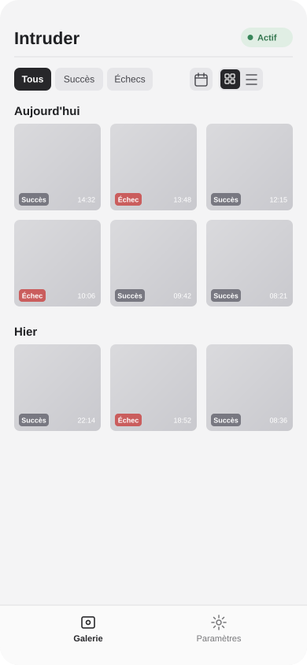
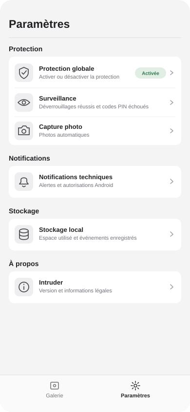
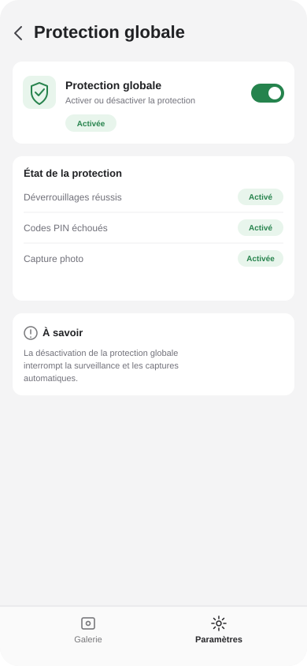
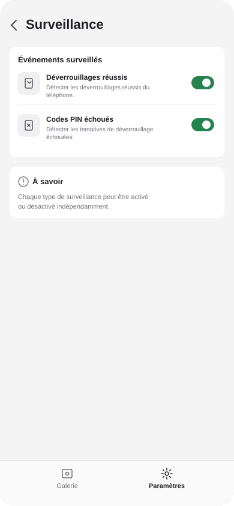
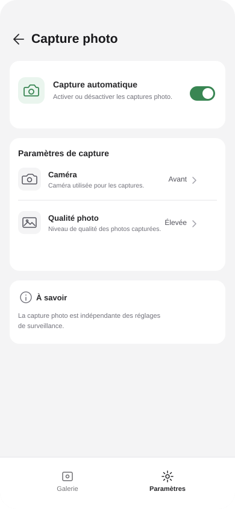
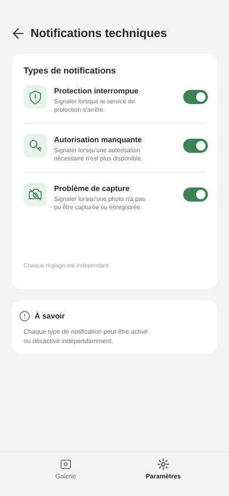
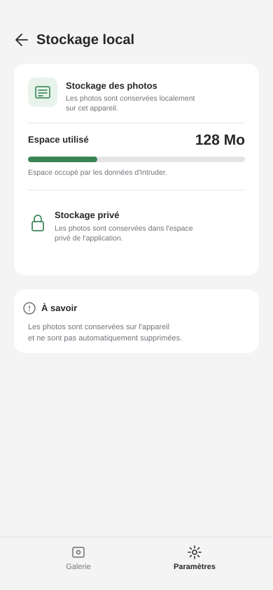

# Maquettes visuelles — Intruder

## Notes générales sur les maquettes

- Les structures et proportions sont validées écran par écran.
- Les couleurs et styles graphiques sont provisoires.
- L'identité visuelle sera définie après la réalisation de toutes les maquettes.
- Les photos et données affichées sont fictives.

## Galerie

### Structure validée

- En-tête :
  - Nom **Intruder** à gauche.
  - Badge d'état de protection à droite.
- Filtres de type :
  - Tous
  - Succès
  - Échecs
- Icône calendrier pour accéder au choix de période.
- Sélecteur de présentation **Grille / Liste** :
  - Toujours visible.
  - Le mode actif est mis en évidence.
- Présentation en grille :
  - Trois colonnes.
  - Vignettes carrées.
- Regroupement des événements par date :
  - Aujourd'hui
  - Hier
  - Dates précédentes.
- Informations sur chaque vignette :
  - Badge du type d'événement en bas à gauche.
  - Heure en bas à droite.
- Navigation inférieure :
  - Galerie
  - Paramètres

### États et interactions

- La grille est le mode d'affichage par défaut.
- Le dernier mode utilisé est conservé.
- Les filtres de type et de période sont combinables.
- Les filtres actifs sont visuellement différenciés.
- Le calendrier permet de choisir une période personnalisée.
- Un appui long sur une vignette active le mode sélection multiple.

---

## Paramètres

### Structure validée

La page Paramètres présente les catégories et leurs principales sous-rubriques directement sur l'écran.

- **Protection**
  - Protection globale.
  - Surveillance.
  - Capture photo.
- **Notifications**
  - Notifications techniques.
- **Stockage**
  - Stockage local.
- **À propos**
  - Informations sur Intruder et sa version.

Chaque sous-rubrique est présentée sous forme de ligne :
- Icône à gauche.
- Titre et courte description.
- Flèche à droite indiquant l'accès à un écran de détail.

Les catégories sont regroupées dans des cartes distinctes.

Navigation inférieure :
- Galerie.
- Paramètres (actif).

### États et interactions

- Chaque ligne ouvre sa page de réglages correspondante.
- Les réglages détaillés sont accessibles depuis ces sous-pages.
- La page Paramètres sert de point d'entrée vers les différentes catégories.

## Protection globale

### Structure

- En-tête :
  - Flèche de retour vers Paramètres.
  - Titre « Protection globale ».
- Carte principale :
  - Icône de protection.
  - Titre « Protection globale ».
  - Description « Activer ou désactiver la protection ».
  - Switch d'activation.
  - Badge indiquant l'état global.
- Carte « État de la protection » :
  - Déverrouillages réussis.
  - Codes PIN échoués.
  - Capture photo.
  - Un badge indépendant pour chaque fonction.
- Carte informative :
  - Explication des conséquences de la désactivation globale.

Navigation inférieure :
- Galerie.
- Paramètres (actif).

### États et interactions

- Le switch permet d'activer ou de désactiver la protection globale.
- Le badge principal reflète l'état global.
- Les états des déverrouillages réussis, des codes PIN échoués et de la capture photo dépendent de leurs réglages respectifs.
- Ces trois fonctions ont des états indépendants.
- La désactivation globale interrompt la surveillance et les captures automatiques.

## Surveillance

### Structure

- En-tête :
  - Flèche de retour vers Paramètres.
  - Titre « Surveillance ».
- Carte « Événements surveillés » :
  - Déverrouillages réussis :
    - Icône.
    - Titre et description.
    - Interrupteur d'activation.
  - Codes PIN échoués :
    - Icône.
    - Titre et description.
    - Interrupteur d'activation.
- Carte informative :
  - Rappel de l'indépendance des deux réglages.

Navigation inférieure :
- Galerie.
- Paramètres (actif).

### États et interactions

- Les déverrouillages réussis et les codes PIN échoués peuvent être activés ou désactivés indépendamment.
- Chaque interrupteur reflète le réglage correspondant.
- Les autorisations nécessaires à chaque type de surveillance sont prises en compte.

## Capture photo

### Structure

- En-tête :
  - Flèche de retour vers Paramètres.
  - Titre « Capture photo ».
- Carte « Capture automatique » :
  - Icône de caméra.
  - Titre et description.
  - Interrupteur d'activation.
- Carte « Paramètres de capture » :
  - Caméra : Avant.
  - Qualité photo : Élevée.
- Carte informative :
  - Rappel de l'indépendance entre la capture photo et les réglages de surveillance.

Navigation inférieure :
- Galerie.
- Paramètres (actif).

### États et interactions

- L'interrupteur permet d'activer ou de désactiver la capture photo.
- Le réglage de la caméra permet de choisir la caméra utilisée.
- Le réglage de qualité permet de choisir la qualité des photos.
- La capture photo possède un réglage indépendant de la surveillance.

## Notifications techniques

### Structure

- En-tête :
  - Flèche de retour vers Paramètres.
  - Titre « Notifications techniques ».
- Carte « Types de notifications » :
  - Protection interrompue :
    - Icône de protection.
    - Description : Signaler lorsque le service de protection s'arrête.
    - Interrupteur d'activation.
  - Autorisation manquante :
    - Icône de clé.
    - Description : Signaler lorsqu'une autorisation nécessaire n'est plus disponible.
    - Interrupteur d'activation.
  - Problème de capture :
    - Icône de caméra.
    - Description : Signaler lorsqu'une photo n'a pas pu être capturée ou enregistrée.
    - Interrupteur d'activation.
- Carte informative :
  - Rappel de l'indépendance des trois réglages.

Navigation inférieure :
- Galerie.
- Paramètres (actif).

### États et interactions

- Chaque type de notification possède son propre interrupteur.
- Les trois catégories peuvent être activées ou désactivées indépendamment.
- Les notifications sont envoyées selon les catégories activées.

## Stockage local

### Structure

- En-tête :
  - Flèche de retour vers Paramètres.
  - Titre « Stockage local ».
- Carte « Stockage des photos » :
  - Rappel de la conservation locale des photos.
  - Espace utilisé par Intruder.
  - Indicateur visuel de l'espace occupé.
  - Mention du stockage privé de l'application.
- Carte informative :
  - Rappel de l'absence de suppression automatique.

Navigation inférieure :
- Galerie.
- Paramètres (actif).

### États et interactions

- L'espace utilisé reflète le volume occupé par les données d'Intruder.
- L'indicateur visuel évolue en fonction de l'espace utilisé.
- Les photos sont conservées dans le stockage privé de l'application.
- Aucune suppression automatique n'est effectuée en V1.